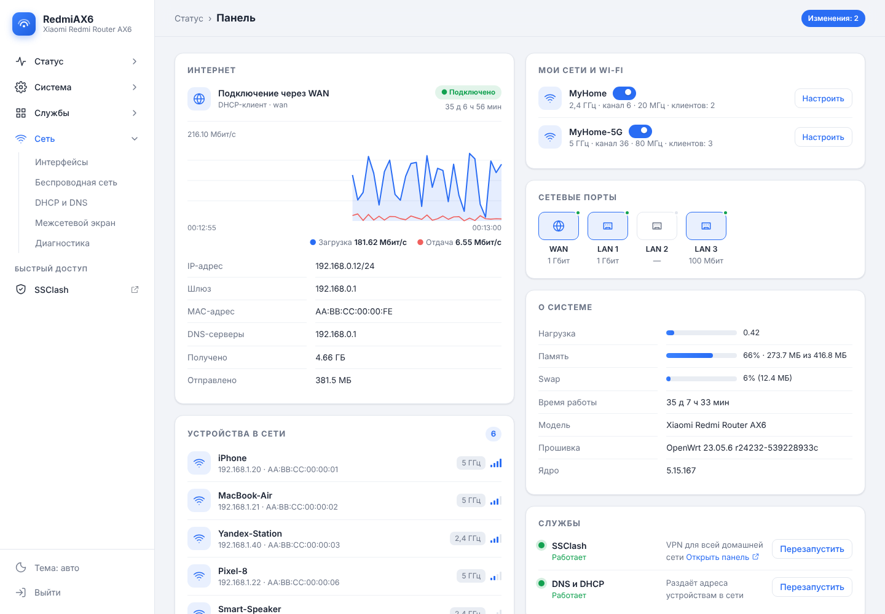
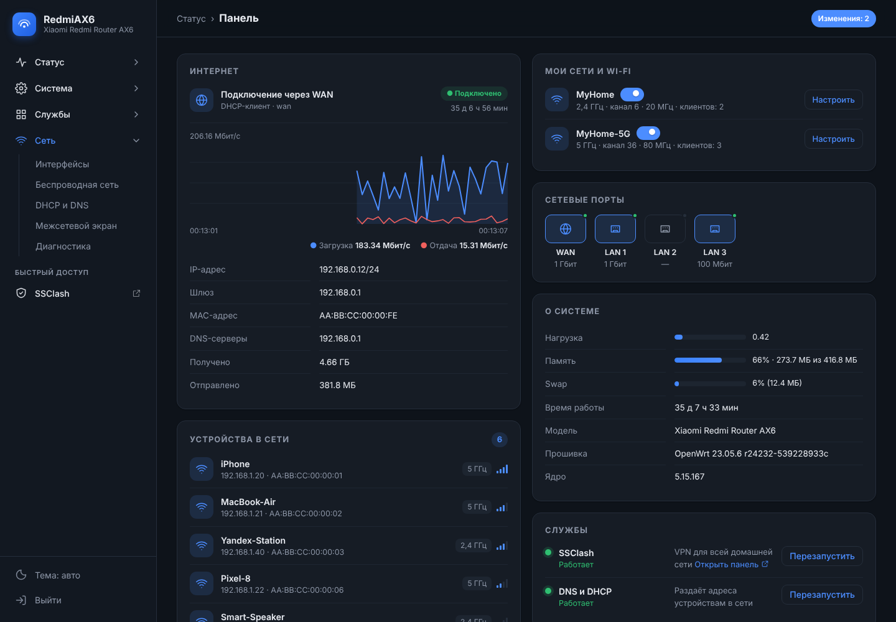
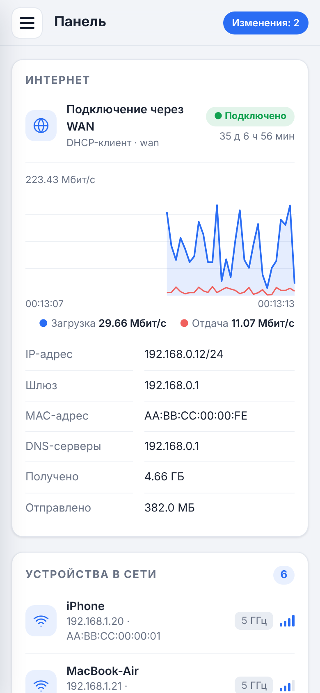
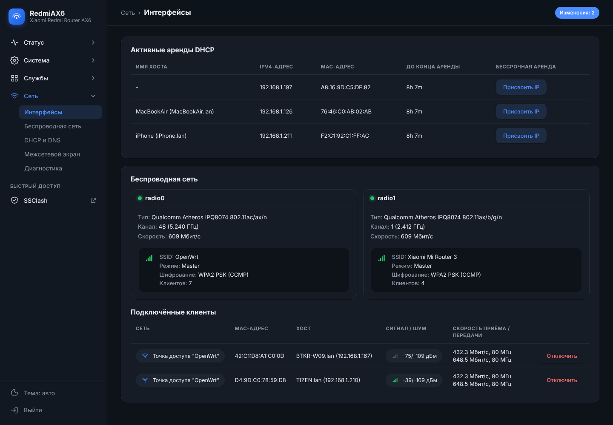
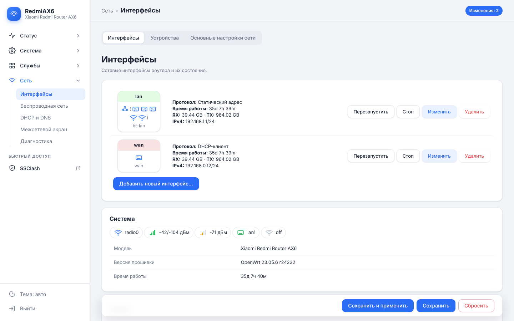

# luci-theme-bobr

Современная тема для веб-интерфейса OpenWrt (LuCI) с боковым меню, карточками, тёмной версией и стартовой **Панелью** в духе Keenetic.



## Что внутри

- **Боковое меню с иконками.** Разделы раскрываются по нажатию, текущая страница подсвечена. На телефоне меню прячется под кнопку ☰.
- **Панель — стартовая страница:**
  - **Интернет:** статус подключения и живой график скорости загрузки и отдачи;
  - **Мои сети и Wi-Fi:** сети с переключателями вкл/выкл;
  - **Устройства в сети:** имя, IP, MAC, диапазон 2,4 или 5 ГГц и уровень сигнала;
  - **Сетевые порты:** какие заняты и на какой скорости;
  - **О системе:** нагрузка, память, swap, время работы;
  - **Службы:** SSClash, Podkop и DNS/DHCP с кнопкой «Перезапустить». Показываются только установленные.
- **Карточки вместо таблиц-простыней.** Аккуратные поля, кнопки и вкладки-переключатели. Кнопки «Сохранить / Применить» прилипают к низу экрана.
- **Светлая, тёмная и автоматическая темы.** Переключатель внизу бокового меню.
- **Понятные названия.** «Имя сети» вместо SSID, «Защита» вместо «Шифрование», «Wi-Fi 5 ГГц» вместо radio0, «Закрепить IP» вместо «Присвоить IP» и так далее. Скорости клиентов показаны без технических MCS/NSS.
- **Современные значки** вместо старых пиксельных картинок LuCI.
- **Быстрый доступ к SSClash.** Ссылка на панель на порту 9091 появляется, если SSClash установлен.
- **Лёгкая.** Около 90 КБ, работает поверх стандартной темы Bootstrap. Всё рисует браузер, лишней нагрузки на память роутера нет.

| Тёмная тема | Телефон |
|---|---|
|  |  |

| Wi-Fi и подключённые устройства | Интерфейсы |
|---|---|
|  |  |

## Совместимость

- **OpenWrt 23.05.x** (LuCI на ucode) — проверено.
- **OpenWrt 24.10.x** — должна работать, но не проверялась.
- Нужна стандартная тема `luci-theme-bootstrap`. Она стоит в OpenWrt по умолчанию.

## Установка

### Вариант 1. Одной командой на роутере

Подключитесь к роутеру по SSH (`ssh root@192.168.1.1`) и выполните:

```sh
wget -O /tmp/install-bobr-theme.sh https://raw.githubusercontent.com/GITHUB_USER/luci-theme-bobr/main/install-bobr-theme.sh && sh /tmp/install-bobr-theme.sh
```

### Вариант 2. С компьютера

1. Скачайте файл [`install-bobr-theme.sh`](install-bobr-theme.sh).
2. В терминале на компьютере (macOS или Linux) выполните:

```sh
scp -O install-bobr-theme.sh root@192.168.1.1:/tmp/ && ssh root@192.168.1.1 'sh /tmp/install-bobr-theme.sh'
```

На Windows можно перенести файл через WinSCP и запустить его в PuTTY: `sh /tmp/install-bobr-theme.sh`.

### После установки

1. **Выйдите из веб-интерфейса и войдите снова.** Панели нужны свои права доступа, а они подхватываются при входе.
2. Обновите страницу с очисткой кэша: **Cmd+Shift+R** на Mac или **Ctrl+F5** на Windows.

Переключаться между темами можно в разделе **Система → Система → Язык и оформление**.

### Вариант 3. Сборка пакета (.ipk)

Папка [`luci-theme-bobr`](luci-theme-bobr) — обычный пакет LuCI. Положите её в `feeds/luci/themes/` дерева сборки OpenWrt, выберите **LuCI → Themes → luci-theme-bobr** в `make menuconfig` и соберите:

```sh
make package/feeds/luci/luci-theme-bobr/compile
```

## Удаление

```sh
wget -O /tmp/install-bobr-theme.sh https://raw.githubusercontent.com/GITHUB_USER/luci-theme-bobr/main/install-bobr-theme.sh && sh /tmp/install-bobr-theme.sh --remove
```

Тема и Панель удалятся, интерфейс вернётся к стандартной теме.

Если веб-интерфейс вдруг перестал открываться, вернуть стандартную тему можно и вручную по SSH:

```sh
uci set luci.main.mediaurlbase=/luci-static/bootstrap && uci commit luci && rm -rf /tmp/luci-*
```

## Частые вопросы

**На Панели ошибка доступа или пустые блоки.** Выйдите из интерфейса и войдите снова. Права Панели применяются только к новой сессии.

**Справа вверху метка «Theme fallback».** В настройках указана тема, которой нет на роутере. Установщик это исправляет. Вручную тему можно выбрать в разделе «Система → Язык и оформление».

**Хочу вернуть оригинальные термины (SSID и т. д.).** Удалите строку `names.js` из файла `/usr/share/ucode/luci/template/themes/bobr/header.ut` или очистите словарь в `/www/luci-static/bobr/names.js`.

**Как добавить своё название?** Откройте `/www/luci-static/bobr/names.js` и допишите пару `'Английская фраза LuCI': 'Как показывать'`.

## Структура

```
luci-theme-bobr/
├── htdocs/luci-static/bobr/cascade.css       оформление (поверх bootstrap)
├── htdocs/luci-static/bobr/names.js          понятные названия
├── htdocs/luci-static/resources/menu-bobr.js боковое меню, вкладки, шапка
├── htdocs/luci-static/resources/view/bobr/dashboard.js   Панель
├── ucode/template/themes/bobr/*.ut           шаблоны страницы и входа
└── root/                                     пункт меню, права, автонастройка
install-bobr-theme.sh                         установщик (собирается build-installer.py)
```

После правок в `luci-theme-bobr/` пересоберите установщик: `python3 build-installer.py`.

## Лицензия

[Apache License 2.0](LICENSE). Тема основана на [luci-theme-bootstrap](https://github.com/openwrt/luci/tree/master/themes/luci-theme-bootstrap) проекта OpenWrt LuCI. Keenetic — товарный знак его владельца. Тема не связана с Keenetic и лишь повторяет удобную раскладку.
